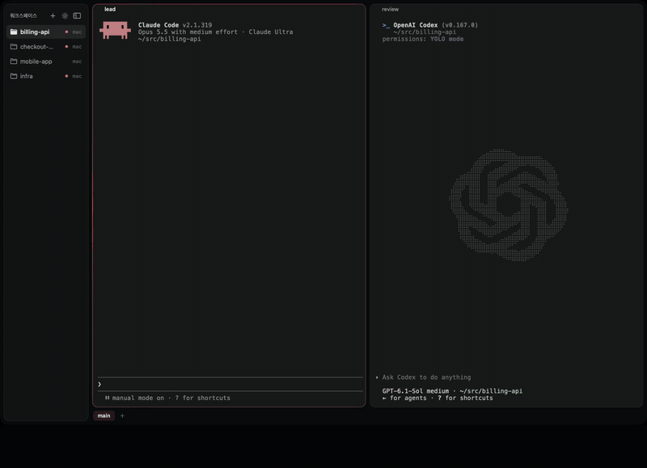
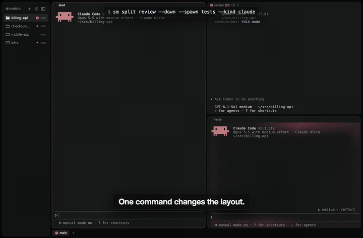
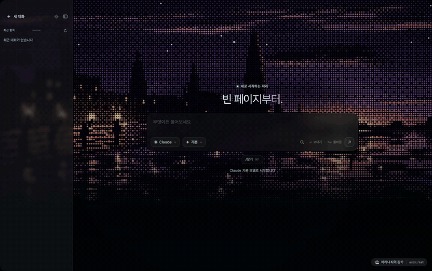

# seol

Coding agents that stay alive, talk to each other by name, and live in two Mac apps.

seol is the setup I run every day with Claude Code and Codex, in one place. Give [SETUP.md](SETUP.md) to your coding agent and it sets the same thing up on your machine.

| | |
|---|---|
| **seol** (this repository) | The session layer. Each agent is a named session held by a small `peer-hold` process, so closing a window, quitting an app or rebooting does not end it. Idle agents sleep and wake on use; updated engines reach them once they are idle. |
| **[peer](https://github.com/oesoll/peer)** | Messages between your coding agents, by name, through each engine's own input path. Nothing is typed into a terminal. |
| **[sm](https://github.com/oesoll/SpaceManager)** | Where your agents live: a Mac app that lays sessions out as workspaces, tabs and panes, with one command per change. |
| **[Fine](https://github.com/oesoll/Fine)** | A quiet Mac window for the coding agents you already use. |







<sub>Home scenes in Fine: [ascii.rest](https://github.com/bas3line/ascii) by bas3line (MIT).</sub>

## Install

Paste this into Claude Code or Codex:

```
Set up seol for me: read https://raw.githubusercontent.com/oesoll/seol/main/SETUP.md and follow it.
```

Or by hand:

```sh
git clone --recursive https://github.com/oesoll/seol ~/.local/share/seol
sh ~/.local/share/seol/install.sh --accept-inbound --codex-alias
```

macOS 14+ on Apple Silicon (the apps come prebuilt); the session layer and peer also run on Linux, where Rust builds `peer-hold`. Needs git and Python 3.9+.

## Use

```sh
sm spawn review --kind codex --cwd ~/src/app     # a named agent that survives restarts
peer say review "please check src/auth.ts"       # delivered · its reply comes back to the sender
sm split review --right --spawn tests --kind claude
sm stop review                                   # ends it on purpose; sm resume review brings it back
```

`sm --help` and `peer -h` list the rest. The agent skills `seol` and `peer` teach your agents the same.

## Repositories

peer, sm and Fine are developed in their own repositories and pinned here at versions that work together. The session layer lives here.

MIT
